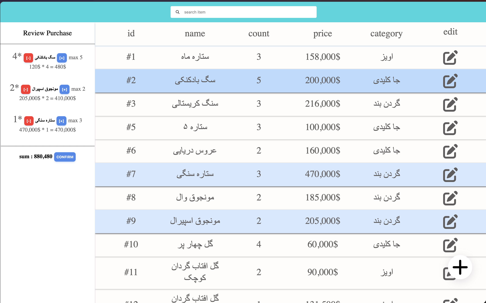
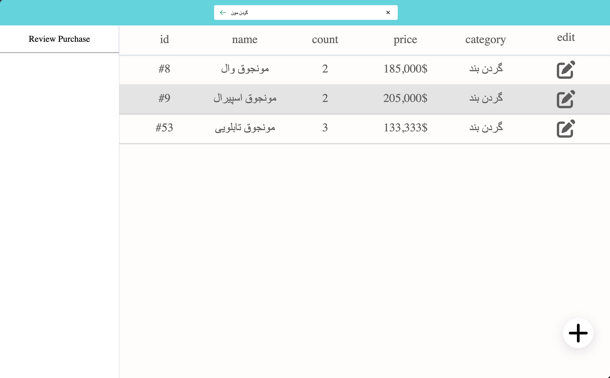
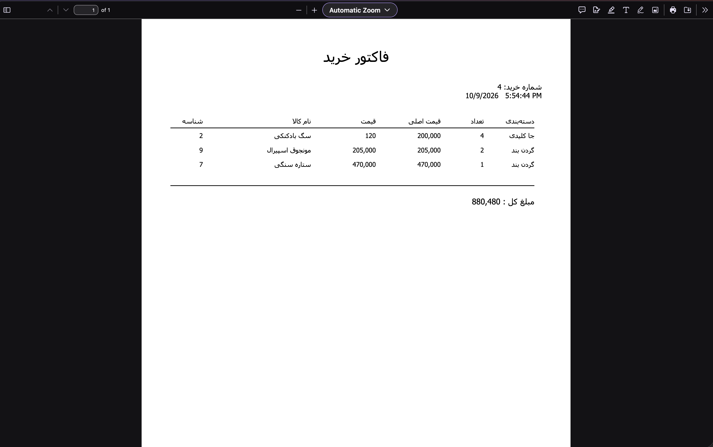
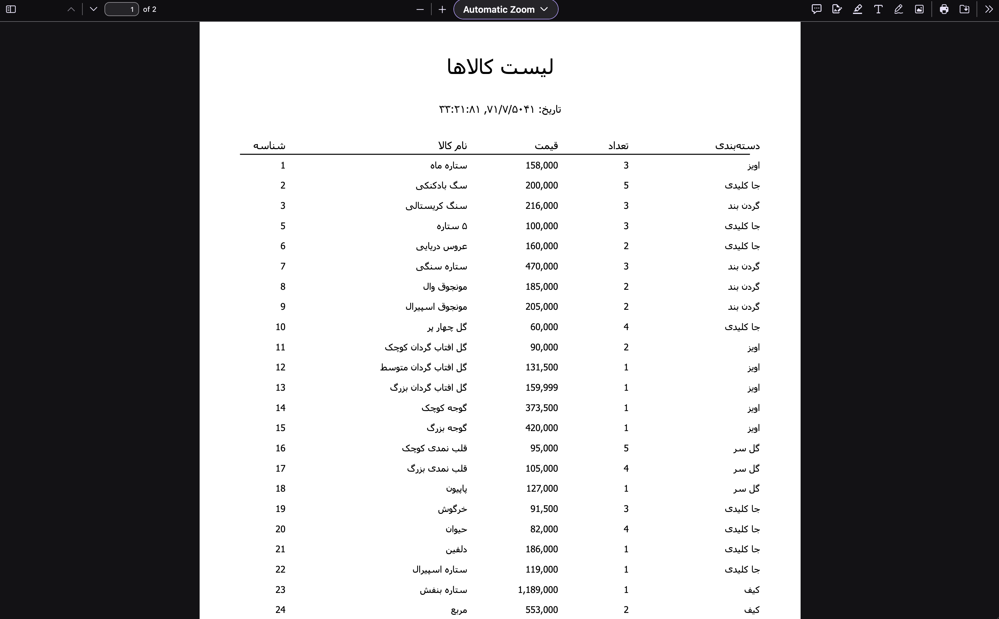

# The Spiral App: Inventory & Sales Management System

An inventory and sales management app built for **Spiral**, a startup of young creators selling handmade products. The team used it **live at their events** to track stock, record sales, and print receipts.

Built from scratch with **Node.js, Express, and SQLite**, with a Persian-language interface.



## Features

- **Stock tracking**: add, edit, and manage products with names, categories, prices, and quantities.
- **Live search**: search-as-you-type with suggestions that narrow as you type, matching item name and category at the same time.
- **Fast sales flow**: find items by searching or browsing, select them (highlighted in blue) to build a purchase list, set the quantity for each item, and adjust prices live to apply discounts.
- **PDF receipts**: confirming a sale generates a receipt showing the original price, the adjusted price, and the purchase details.
- **PDF inventory report**: export the full list of items in stock as a PDF.
- **Purchase records**: view and manage past purchases, with totals calculated automatically and large numbers formatted with thousands separators.
- **Zero-setup database**: SQLite stores everything locally, so no separate database server is needed.

## Screenshots

| Main screen | Search |
| --- | --- |
|  |  |
| Add, edit, and search items. Select items to build a purchase list, set quantities, and adjust prices live for discounts. | Suggestions narrow down as you type, across names and categories. |

| PDF receipt | PDF inventory report |
| --- | --- |
|  |  |
| Generated on confirmation, showing the original and adjusted prices along with the purchase details. | The full list of items in stock, exported as a PDF. |

## Tech Stack

| Technology | Purpose |
| --- | --- |
| **Node.js** | Backend runtime |
| **Express.js** | HTTP server and REST API |
| **SQLite** with **better-sqlite3** | Database |
| **PDFKit** | PDF generation |
| **HTML / CSS / JavaScript** | Frontend (no framework) |

## Getting Started

**Requirements:** [Node.js](https://nodejs.org/) installed.

```bash
git clone https://github.com/KaarenMesbah/the-spirals-inventory.git
cd  the-spirals-inventory
npm install
node server.js
```

Then open `http://localhost:5756` in your browser.

## About the Project

I built this independently for Spiral, from the database and REST API to the interface and PDF generation. It was used in real conditions at their events, which shaped the design: a fast search, a quick sales flow, and receipts that clearly show discounts.

## Author

Full-stack developer
GitHub: [KaarenMesbah](https://github.com/KaarenMesbah)
